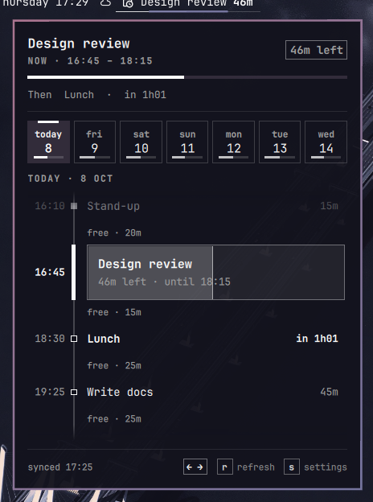
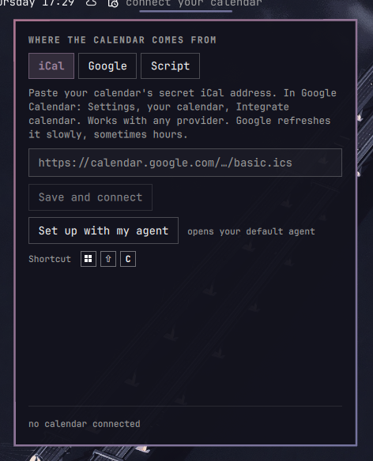

# Agenda

The calendar block that is on now and how long is left, in the Omarchy bar. Hover for the next block. Click for the day and week agenda.




Read-only. English interface; event titles are shown exactly as your calendar has them.

## Screenshots

Source selection, in settings:



The images come from made-up data (`tools/demo_events.py`), regenerated with `tools/screenshots.py`.

## Install and connect

```sh
omarchy plugin add <repository-url> --enable
```

The first time the panel opens it goes straight to **settings**. Pick where your calendar comes from, then *Save and connect*. Settings are always one key away: `S` in the panel, or the `settings` link in its footer.

Requires the system `python3`. No external libraries.

### Open it with a key

Add a binding whose description starts with `Agenda`; settings read Hyprland's binding table and show that key:

```lua
-- ~/.config/hypr/bindings.lua
hl.unbind("SUPER + SHIFT + C")   -- Omarchy's default: the HEY calendar web app
o.bind("SUPER + SHIFT + C", "Agenda", "omarchy-shell shell toggle danitrrga.agenda '{}'")
```

The same key opens and closes the panel; `Esc` closes it from anywhere in it.

### Set it up with your agent

Omarchy is built around coding agents. In settings, **Set up with my agent** opens your default agent with a prompt that points it to [`SETUP-WITH-AGENT.md`](SETUP-WITH-AGENT.md): where the config lives, how to change it, and the rule that credentials never go through the chat.

## The three sources

### iCal: it just works

Paste your calendar's secret iCal address. In Google Calendar: Settings, your calendar, *Integrate calendar*, **Secret address in iCal format**. Proton, Fastmail, Nextcloud and any provider that gives a `.ics` URL work too (`webcal://` is fine).

Google refreshes that address slowly, sometimes hours, so a new event may not appear right away.

### Google: your own account, nobody in between

Each person creates their own OAuth client, so Google does not have to review or approve anything about this plugin.

1. In [Google Cloud](https://console.cloud.google.com/) create a project and enable the **Google Calendar API**.
2. OAuth consent screen: *External*, your address as a test user.
3. Credentials, *Create credentials*, *OAuth client ID*, type **Desktop app**.
4. Paste the ID and secret in settings and press *Sign in*: the browser opens, you accept, and you are back.

It asks for read-only access (`calendar.readonly`), reads every calendar you have switched on in Google Calendar, and changes show up on refresh without iCal's delay.

**Important:** while the app is in *Testing* mode the session token expires after 7 days. To stop that, publish it as *In production* (it is your own app: Google only shows an unverified-app notice). When it expires the plugin says so, and signing in again fixes it.

### Script: your own system

For people who already have an agent, a sync, or their own route to their calendar. In settings, write a command. The plugin runs it (without a shell, every 10 minutes and when the panel opens, if the last reading is over two minutes old) and expects a JSON document:

- If the command contains `{out}`, that text is replaced by a path and the command must write the JSON there.
- Otherwise the JSON is read from its standard output.
- A non-zero exit code is an error; the last line of its stderr is shown in the panel.
- The command is split the way a shell would split it, but no shell runs it: quote a path that contains spaces.
- Optional: a file to watch. When it changes the plugin refreshes at once (handy if an agent rewrites a cache).

```json
{
  "as_of": "2026-10-08T16:06:06+02:00",
  "events_by_date": {
    "2026-10-08": [
      {
        "id": "abc",
        "summary": "Block title",
        "start": "2026-10-08T16:00:00+02:00",
        "end": "2026-10-08T17:30:00+02:00",
        "location": "",
        "description": "",
        "recurring": false
      },
      { "id": "bday", "summary": "All day", "start": "2026-10-09", "end": "2026-10-10" }
    ]
  }
}
```

Format rules: `start` and `end` are ISO with a time zone, or a bare date (`YYYY-MM-DD`) for all-day events. Events are listed under the day they start; one that crosses midnight is also drawn on the next day. To mark a calendar that could not be read, put `{"error": "message"}` in the list: the panel warns instead of showing an empty day. Seven days from today's midnight are shown.

## Security

Everything is stored in `~/.config/omarchy/agenda/config.json`, mode `600`. The plugin never writes a credential into an error message or into the state it exposes, and the form never shows a stored value again (it only says one exists). The iCal address and the Google secret are credentials: whoever has them can read your calendar. The script's command runs with your permissions.

## Limits

- iCal recurrence is expanded inside the plugin: daily, weekly, monthly and yearly with interval, `COUNT`, `UNTIL`, `BYDAY` (also `1MO`, `-1FR`), `BYMONTHDAY`, `BYMONTH`, exceptions and single-instance edits. A rule beyond that (`BYSETPOS`, week numbers, hours) is shown once and flagged.
- A time zone Python does not know (Windows names, for example) is read as local time.
- One language: English.

## Use

Left click opens the panel, middle click refreshes, right click opens Google Calendar. In the panel: arrows or `h`/`l` change day, `j`/`k` scroll, `t` goes to today, `r` refreshes, `s` opens settings, `Esc` closes. The panel's footer shows only the arrows and `s`; settings show the shortcut that opens the panel.

## Tests

```sh
TZ=Europe/Amsterdam node tests/model_test.js Model.js
python3 tests/test_fetch_ics.py   # the dateutil cross-check is skipped if it is not installed
python3 tests/test_ctl.py         # a local server stands in for Google: no network, no real account
```
